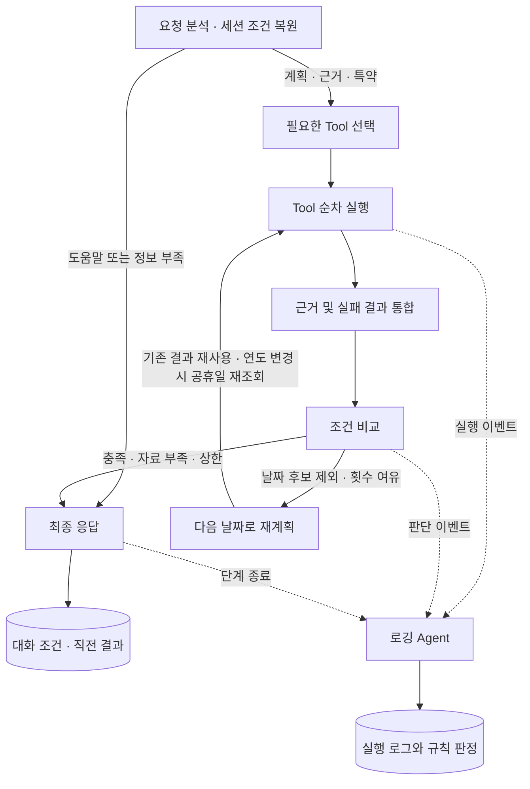

# 실행 구조와 도구

## 실행 그래프

상태에는 메시지·세션·실행 ID, 기준 시각(KST), 직전 조건, 의도, 도구 순서, 인자별 결과, 후보일, 제외 사유, 재계획 횟수, 근거와 일정 초안이 있습니다. Tool을 선택하고 순서를 정하는 규칙은 `backend/agent.py`에 있습니다. 도구 사이에는 실제 응답의 식별자와 좌표만 전달합니다. 단계마다 진입과 종료를 발행합니다. 순서 번호는 실행마다 1에서 시작합니다.

점검일은 오늘과 사용자 시작일 중 늦은 날부터 검토합니다. 확인된 조문의 시행일 ≤ 후보일 ≤ 사용자 기한, 허용 요일, 해당 연도의 공휴일 제외, 시작 시각 + 점검 소요 시간 ≤ 가능 종료 시각을 비교합니다. 현장 점검은 같은 도시의 해당 날짜 예보가 있어야 하며 강수 상한이 있으면 일별 최대 강수확률과 비교합니다. 예보가 없는 날은 맑다고 추정하지 않습니다. 재계획은 다음 날짜 후보를 실제로 평가합니다. 불변 조회 결과는 실행 내에서 재사용합니다. 연도·위치와 같은 인자가 바뀌면 다른 조회입니다.

## 등록 도구

공통 응답 필드는 `ok, data, error, source, basis, cached`입니다. 실패 시 `error.code`와 한국어 `error.message`를 반환합니다. [Pydantic에서 생성한 전체 입출력 스키마](tool-registry.json)

| 이름 / 범위 | 사용하는 상황과 입력 | 반환하는 판단 자료 |
|---|---|---|
| candidates / 외부 | 법률 후보 검색. query와 kind(law, prec, expc) | 법률명·종류·공식 링크·요약과 판본/사건 ID. 기본은 조회 당시 자료이며 snapshot 기준일은 2026-10-23 |
| detail / 외부 | 후보 응답의 api_id와 kind, 검토 주제 | 조문 문서 ID, 제목, 원문 발췌, 시행일과 공식 링크. 판례·해석례는 사건 자료로 취급 |
| holidays / 외부 | 후보일에서 연도 추출 | 한국 공휴일 날짜·이름·출처 |
| city / 외부 | 현장 방문 도시 이름 | 한국 검색 결과의 대표 도시명과 위·경도, GeoNames 링크 |
| weather / 외부 | city 결과의 위·경도 | 한국 시각 기준 날짜별 최대 강수확률(%)과 조회 링크 |
| rag / 로컬 | 특약이나 법률 근거 질문 | 색인의 상위 문서 최대 3건, 실제 문서 ID·출처·본문 발췌. 2회차 검색기와 앵커 문서를 재사용 |

공통 실패 코드는 `BAD_INPUT`, `NO_RESULTS`, `NO_ATTRIBUTE`, `MISSING_KEY`, `UPSTREAM`, `NO_FIXTURE`, `NO_INDEX`, `RAG_UNAVAILABLE`입니다. 인증·형식·네트워크 오류는 내부 예외와 분리합니다. 성공한 Tool 요청은 최대 256개를 30분 동안 보관하고, 법제처 원본 응답에는 2회차의 24시간 디스크 캐시도 적용합니다.

## 데이터 출처와 이용 조건

| API | 확인한 이용 조건과 적용 |
|---|---|
| 법제처 국가법령정보센터 DRF 법령·판례·해석례 목록·본문 | 운영 서버 IP·도메인과 OC 승인 필요. 링크에서 OC 제거, 공식 출처 표시, 최소 호출 간격 0.4초, 3회차 네트워크 재시도 0회. 공통 수치형 일일 할당량 미확인. [이용 안내](https://open.law.go.kr/LSO/information/guide.do) · [API별 명세](https://open.law.go.kr/LSO/openApi/guideList.do) |
| Nager.Date 한국 공휴일 | 인증 없는 v3 연간 목록으로 실측. 기관 영업일을 제공하는 자료는 아니며 서비스에서는 개인 일정의 제외일로 사용. 연도별 캐싱, 오류 시 중단. v3의 보장 할당량과 SLA는 확인되지 않음. [제공자 및 API 안내](https://github.com/nager/Nager.Date) |
| Open-Meteo Geocoding / GeoNames | 한국 도시만 검색. 도시 중심점은 특정 주택의 위치를 뜻하지 않음. 교육용 비상업 접근과 출처 표시. [Geocoding 명세](https://open-meteo.com/en/docs/geocoding-api) |
| Open-Meteo Forecast | 교육 목적 무료 API. CC BY 4.0, 분당 600·시간당 5,000·일 10,000회 미만 조건. 실제 호출은 도시 검색과 7일 예보 각 1회 단위이며 재계획에서 재사용. 공개 서버 다중 사용자 부하에 대한 할당량 제어는 별도 필요. [이용조건](https://open-meteo.com/en/terms) · [예보 명세](https://open-meteo.com/en/docs) |

## API 및 저장

| 요청 | 결과 |
|---|---|
| POST /api/chat | UUID session_id와 message. 상태·초안·제외 사유·오류·근거·원본 실행 이벤트 |
| GET /api/tools, /api/status, /api/usage | 도구 등록부, 모드·모델·상한, 제공자별 로컬 사용량 |
| POST, GET /api/plans?session_id=… | 생성 및 목록. 생성 응답은 plan과 conflicts |
| GET, PUT, DELETE /api/plans/{id}?session_id=… | 상세·수정·삭제. 인접한 시작·종료 시각은 중복에서 제외 |
| GET /api/logs | 세션 목록 및 이벤트 개수 |
| GET, DELETE /api/logs/{session_id} | 순서대로 원본 이벤트 조회, 세션 기록 및 부속 진단 삭제 |
| GET /api/logs/{session_id}/{run_id}/assessment | 완료된 실행의 규칙 판정 및 저장된 진단 |
| POST /api/logs/{session_id}/{run_id}/diagnosis | 경고가 있는 실행의 짧은 진단을 별도 저장. 정상 실행은 모델 호출 0회 |

계획 중복 조건은 같은 세션·같은 날짜에 기존 시작 < 새 종료, 기존 종료 > 새 시작입니다. 생성·수정과 충돌 조회는 SQLite 단일 쓰기 트랜잭션에서 수행합니다. 대화 메모리는 세션별로 유효 조건·직전 제안·답변 요약만 저장합니다. 원문 로그는 추가와 삭제를 지원합니다. 로그 기록 실패는 발행 경계에서 격리합니다.

## 2회차 코드와의 연결

첨부 ZIP에서 `src/`, `config.py`, 테스트, 앱과 색인·평가 스크립트 및 원문 JSONL을 가져왔습니다. 기존 LegalRAGService.ask와 ModelClient에는 GMS 키 검사 및 OpenAI 호환 클라이언트가 있어 3회차 요청의 진입점은 새 LangGraph로 구성했습니다. LegalAPI의 목록·상세 파서, ContractReview의 쟁점 정규화, Retriever·ChromaStore·LocalEmbeddings, Generator와 validate_answer를 모듈 단위로 호출합니다. 이전 Streamlit용 대화 딕셔너리는 별도 세션 SQLite 메모리로 대체했습니다. 이전 서비스와 테스트 코드는 legacy 폴더에 보존했습니다.
